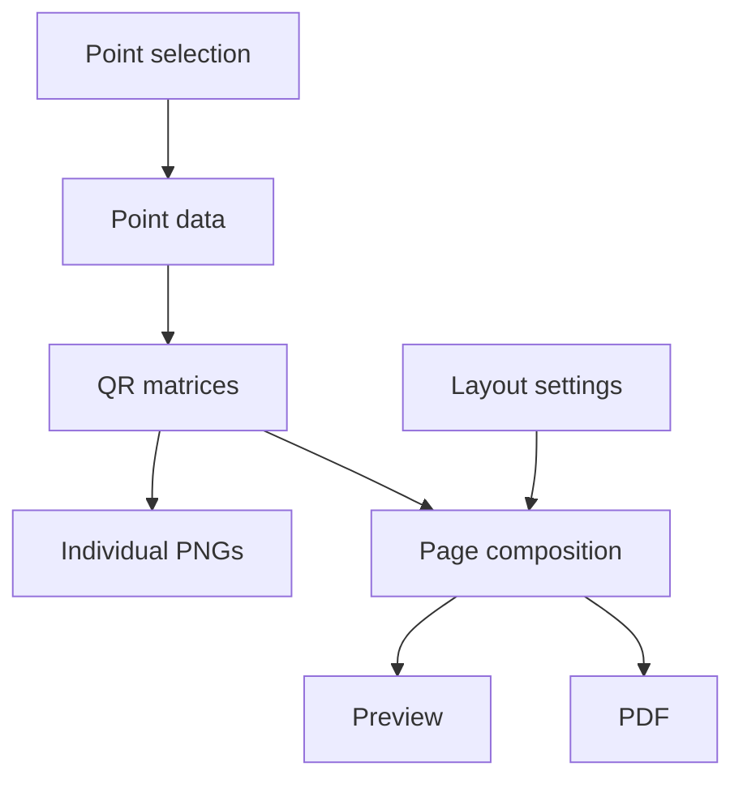

# Architecture

[Русский](ARCHITECTURE.ru.md#архитектура)

In this document, “points” refers to control points and the service codes
for start, finish, and clear.

OrientMark QR is a Flutter desktop application that generates QR codes
and arranges them in layouts for previewing, saving, and printing.

## Separation of responsibilities

| Area | Responsibility |
|---|---|
| Presentation | Selecting points, settings, and the output folder; displaying previews and export progress. |
| Course point model | Describing a point and the data received by the scanner. |
| QR generation | Converting point data into a QR code matrix. |
| Layouts | Positioning QR codes, labels, and assembly elements on printed items. |
| Export | Saving images and documents. |
| Localization | Interface text and language selection. |

The presentation layer uses the model and the generation and export services.
The course point model is independent of the interface and printed layout.

## Data flow

## Main project areas

- `lib/` — application code: the course point model, generation, and export.
- `lib/presentation/` — the interface and visual styling.
- `lib/models/` — printed layout settings.
- `lib/localization/` — providing translations to the interface.
- `assets/l10n/` — language resources.

These responsibility boundaries remain in place as screens, export formats,
and languages are added. Each area's internal file structure evolves with it.

## QR codes and layouts

Points currently follow the OrientMark point formats implemented in
`lib/course_qr.dart`. Each QR code contains a JSON object with a single
`point` field:

| Point type | JSON in the QR code |
|---|---|
| Control point, for example CP 31 | `{"point":{"checkpoint":31}}` |
| Start | `{"point":"start"}` |
| Finish | `{"point":"finish"}` |
| Clear | `{"point":"cleaning"}` |

For control points, `checkpoint` is an integer from 31 to 99 inclusive.
For service codes, `point` is a string: `start`, `finish`, or `cleaning`.
The point identifier, filename, and printed label are not included in the JSON.

QR code contents are determined by the point. Image size, export format,
label language, and assembly method do not change the data received by the scanner.

A layout receives the selected points and positions their QR matrices.
The preview and PDF use the same page composition.
The interface language and printed label language are selected independently.

## Evolving the presentation layer

As the application grows, the view should be split into separate components
for point selection, layout settings, preview, and export.
The main screen should compose these components and supply their data
and action handlers. This will make the code easier to read and the interface
easier to extend.

## Extending layouts

As the application grows, settings and rendering for different layout families
should be separated into individual components. QR generation and the course
point model should remain shared, while export and preview should use the same
composition for the selected layout.

## External interactions

Generation and export run locally.
The application uses `url_launcher` to open the repository and releases page
in the system browser.

## Related documentation

- [Building and publishing](PUBLICATION.md#releasing-the-application)
- [Testing](TESTING.md#testing)
- [Component licenses](../THIRD_PARTY_LICENSES.md#third-party-licenses)
