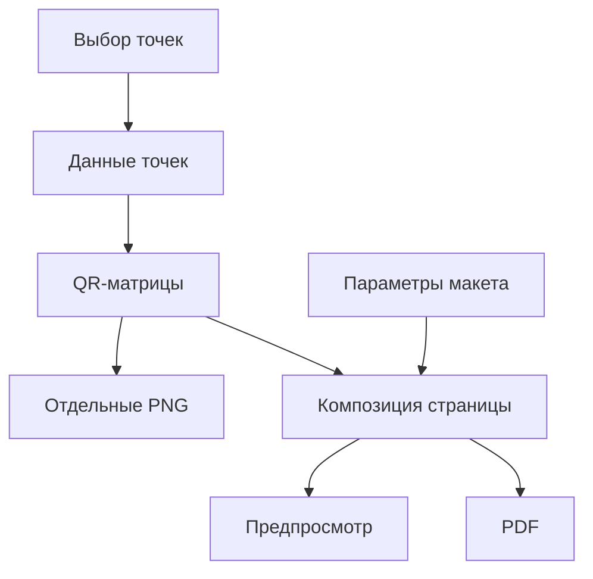

# Архитектура

[English](ARCHITECTURE.md#architecture)

Под «точками» далее в описании подразумеваются КП (контрольные пункты)
и служебные коды: старта, финиша, очистки.

OrientMark QR — настольное Flutter-приложение, которое формирует QR-коды
и размещает их в макетах для просмотра, сохранения и печати.

## Разделение ответственности

| Область | Ответственность |
|---|---|
| Представление | Выбор точек, параметров и папки сохранения; отображение предпросмотра и состояния экспорта. |
| Модель точки трассы | Описание точки и данных, которые получает сканер. |
| Генерация QR | Преобразование данных точки в матрицу QR-кода. |
| Макеты | Размещение QR, подписей и элементов печатного изделия. |
| Экспорт | Сохранение изображений и документов. |
| Локализация | Тексты интерфейса и выбор языка. |

Представление обращается к модели и службам генерации и экспорта.
Модель точки трассы не зависит от интерфейса и печатного макета.

## Поток данных

## Основные области проекта

- `lib/` — код приложения: модель точки трассы, генерация и экспорт.
- `lib/presentation/` — интерфейс и оформление.
- `lib/models/` — параметры печатных макетов.
- `lib/localization/` — предоставление переводов интерфейсу.
- `assets/l10n/` — языковые ресурсы.

Границы ответственности сохраняются при добавлении экранов, форматов экспорта
и языков. Внутреннее разбиение на файлы определяется развитием каждой области.

## QR-код и макет

Сейчас точки формируются на основе форматов точек OrientMark,
реализованных в `lib/course_qr.dart`. В QR-код записывается JSON-объект
с единственным полем `point`:

| Тип точки | JSON в QR-коде |
|---|---|
| Контрольный пункт, например КП 31 | `{"point":{"checkpoint":31}}` |
| Старт | `{"point":"start"}` |
| Финиш | `{"point":"finish"}` |
| Очистка | `{"point":"cleaning"}` |

Для КП значение `checkpoint` — целое число от 31 до 99 включительно.
Для служебных кодов значение `point` — строка: `start`, `finish` или `cleaning`.
Идентификатор точки, имя файла и печатная подпись в JSON не включаются.

Содержимое QR-кода определяется точкой. Размер изображения, формат экспорта,
язык подписи и способ сборки изделия не изменяют данные для сканера.

Макет получает выбранные точки и размещает их QR-матрицы.
Предпросмотр и PDF используют общую композицию страницы.
Язык интерфейса и язык печатных подписей выбираются независимо.

## Развитие представления

В дальнейшем представление (view) приложения рекомендуется разделить на
отдельные компоненты: выбор точек, настройку макета, предпросмотр и экспорт.
Основной экран должен объединять эти компоненты и передавать им данные
и обработчики действий. Это упростит чтение кода и доработку интерфейса.

## Расширение макетов

При расширении приложения параметры и отрисовку разных семейств макетов
следует выделять в отдельные компоненты. Генерация QR и модель точки трассы
должны оставаться общими, а экспорт и предпросмотр — использовать одну
композицию выбранного макета.

## Внешние взаимодействия

Генерация и экспорт выполняются локально.
Через `url_launcher` приложение открывает репозиторий и страницу релизов
в системном браузере.

## Связанная документация

- [Сборка и публикация](PUBLICATION.ru.md#выпуск-приложения)
- [Тестирование](TESTING.ru.md#тестирование)
- [Лицензии компонентов](../THIRD_PARTY_LICENSES.md#third-party-licenses)
